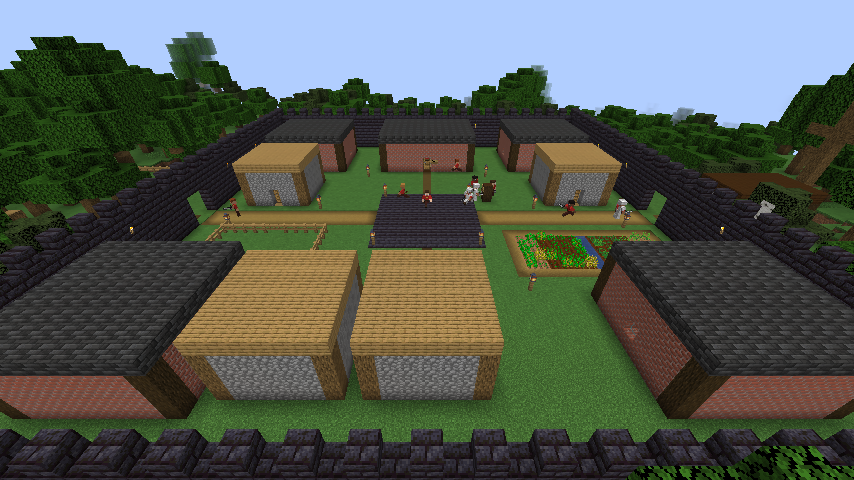

# Faction Clash

An autonomous faction-war simulation mod for **Minecraft Java 1.21.1 / NeoForge 21.1.209 / Java 21**, written
from scratch from the Faction Clash master specification. Four human factions — **Ember Legion, Grove
Covenant, Tide Alliance, Stoneguard** — and the monster faction **The Hollow** build, mine, farm, scout, recruit,
repair and raid on a bounded campaign map without the player having to manage them.

This is the **foundation build** (spec §21 priority order): safe starts, a working central station, useful
starting workers, movement, storage and uninterrupted workspace production first, then recruitment, upgrades,
construction, scouting, combat, levels and raids. Several later systems from the spec are not built yet — see
[Status](#status) for an honest breakdown.

## Install

1. Install **NeoForge 21.1.209** for Minecraft **1.21.1** (Java 21) — client and/or server.
2. Put `factionclash-0.1.0.jar` in the `mods` folder (it is needed on both the server and every client).
3. Start the world/server. As an operator run `/fc start` (or `/fc start <radius>`). Preparing a campaign takes
   1–2 minutes of background work; progress is announced in chat and the server keeps running.
4. Players: `/fc join <ember_legion|grove_covenant|tide_alliance|stoneguard>`, then `/fc base` to teleport home.

No other mods are required. Build from source with `./gradlew build` (jar in `build/libs/`).

## Playing

| Command | Who | What |
|---|---|---|
| `/fc start [radius]` | op | Start a new campaign (map centred on world spawn) |
| `/fc status` | all | Which factions still stand; the winner when there is one |
| `/fc join <faction>` / `/fc leave` | all | Join or leave a human faction |
| `/fc base` | member | Teleport to your faction's base (the player teleport; NPCs always travel physically) |
| `/fc info`, `/fc map` | member | Base report and your faction's delivered map knowledge |
| `/fc admin dump\|npcs\|info <f>\|spawn <f> <role>\|recruit <f> <role>\|probe <x> <z>\|mine <id>\|destroy <id>` | op | Diagnostics, kept separate from player commands |

In the world:
* **Reporting Station** (right-click): population, stock, recruitment decision, workspaces and tiers, projects,
  repairs, delivered reports, raids. Only members (and ops) see their own faction's records.
* **World Map Board**: every report your scouts physically delivered, with age; moving things go *stale*.
* **NPCs** (right-click): identity, job, equipment, backpack, current task, destination, workplace, level,
  affixes. Sneak + right-click with a better tool, weapon, armour piece or arrow to hand it over — the replaced
  item disappears.
* **Construction sign** next to the staging chest lists what the current project still needs.
* **Faction Heart**: destroy it and the base falls. Members' deliberate edits inside their own base are
  preserved by builders; damage from mobs, explosions or enemies is repaired.

Players respawn at their nearest surviving allied base when they have no bed.

## How the simulation works

* **Starting bases** are placed on dry, gentle land: each faction searches its own map sector on real generated
  terrain, widens to the whole map (and a 1.5× map) if needed, and levels the footprint including the mine and
  tree-plot pads. Every base starts with a finished reporting station, map board, faction heart, categorised
  storage (food, raw, building, tools, weapons, armour, special, general), workshop (crafting table, 2 furnaces,
  smoker, anvil, enchanting table with bookshelves), 10 beds, a farm, a pen with 2 cows and 2 pigs, walls with
  gates, lighting, and outside the walls a tier-1 constructed mine and a fenced tree plot. Starter supplies are
  finite and granted once (saved flag).
* **Ten starting NPCs**: builder, miner, farmer, woodcutter, blacksmith, chef, scout and three swordsmen.
* **No hunger, no wear**: NPCs never eat or starve; equipped gear never loses durability; archers hold one arrow
  that is never used up (tipped/spectral effects apply to every shot, and shots cannot be picked up).
* **Workspaces**: every production worker has a personal, saved workplace and cycle; output becomes real items in
  the worker's backpack and is carried to storage; full storage pauses work without deleting anything.
* **Constructed mines**: one output per completed cycle with exactly one swing, crack progress on the face
  during the cycle. Output depends on mine tier **and** pickaxe tier. Upgrades are paid with a real pickaxe plus
  torches, stairs (which NPCs craft) and sealing blocks, and are dug out step by step downward; water, lava and
  sand are sealed before cells are opened, and cave-ins or floods are cleared.
* **Tree plots** grow from 4 to 9 to 16 trees; woodcutters fell real trees, clear canopies (saplings, apples),
  replant and tend saplings with the vanilla growth step.
* **Farmer, chef, smelter, blacksmith** use the real farm, smoker, furnaces and crafting recipes. The blacksmith
  crafts batches from real needs: mine-upgrade pickaxes, better worker tools, iron swords and armour for soldiers
  first, bows, torches, sticks, diamond gear when diamonds exist.
* **Recruitment** replaces missing workers and grows the garrison (40% archers by default) up to the number of
  beds; it charges food by normal hunger value plus exactly one equipment payment route.
* **Builders** queue houses (with straw bedrolls made from wheat) and storage expansions, carry materials to the
  staging chest, build bottom-up from saved plans with substitutes for unavailable styled blocks, and repair any
  damaged plan block.
* **Scouts** explore unexplored map sectors, record only what they see (settlements, lairs, monsters, caves,
  forests, water, exposed ore), retreat home on danger along a fixed route, and publish by reaching the station.
* **War**: guards patrol, pick up loot and answer a base defence alarm; hostile vanilla mobs hunt NPCs; zombies
  and skeletons do half damage to NPCs; wounded civilians flee and call guards; NPCs jump back from priming
  creepers. Factions raid targets their scouts reported, keeping home defenders; raiders travel physically, break
  the target's heart, loot its storage and carry it home. Hollow lairs grow and raid nearby settlements.
* **Levels**: completed work earns XP for the NPC that did it; every level grants one capped affix (e.g. extra
  ore, instant sapling regrowth); reloads never re-stack bonuses.
* **Background simulation** is bounded: base areas and travelling NPCs hold ticking chunk tickets, so factions
  progress away from players without loading the whole map.

All numbers that the spec left open are documented as proposals in [BALANCE.md](BALANCE.md) and most are
configurable.

### Config file

The config is **not** part of this repository: NeoForge creates `config/factionclash-common.toml` inside your
Minecraft instance (or server) folder the first time the game starts with the mod. Edit that file while the game
is closed. A copy with the default values is in [docs/factionclash-common.toml](docs/factionclash-common.toml)
for reference; you can also place it in your `config` folder before the first launch.

## Status

Legend — **U** unit test, **G** in-game GameTest (headless server), **S** observed in the multi-day dedicated
server simulation, **—** implemented but not separately verified, **✗** not implemented.

| Spec area | State | Verified |
|---|---|---|
| §1 Factions, bounded map, join/teleport/respawn, last-faction-standing victory | Implemented (victory rule proposed: faction heart) | S (bases destroyed, a faction eliminated); player join/respawn — (no client was connected) |
| §2 No hunger, nutrition-weighted recruitment, no gear wear, equipment cost, one arrow, finished station at start | Implemented | U, G, S |
| §2/§16 Great People (HSR/ZZZ characters), starter hero, 10-minute revival | ✗ not implemented | — |
| §3 Safe starting bases, roster, supplies once, animals, enchanting setup | Implemented | S (incl. save/reload) |
| §4 Roles: builder, miner, farmer, woodcutter, blacksmith, chef, smelter, scout, swordsman, archer | Implemented | S |
| §4 Roles: animal carer, butcher, fisherman, enchanter, quartermaster/hauler, cave explorer, axe fighter, crossbowman, field medic, TNT expert, rail engineer | ✗ not implemented | — |
| §5–6 Workspaces, constructed mines, tiers, pickaxe-gated loot, staircase upgrades | Implemented | U, S (mines reached tier 4) |
| §7 Natural cave mining with depletion | ✗ (scouts report caves only) | — |
| §8 Tree plots + upgrades, farm, chef | Implemented | S |
| §8 Pens/breeding/butchering, fishing | ✗ | — |
| §9 Golden apples used by NPCs | ✗ | — |
| §10 Categorised storage, blacksmith batches, soldier armour priority | Implemented (no hauler role) | G (storage), S |
| §11 Builder projects, staging chest + signs, repairs, player-edit preservation | Implemented (houses, storage expansion) | S |
| §11 Perimeter expansion, outposts, procedural building variety | ✗ | — |
| §12 Scouts, reports, map board, stale sightings, retreat, overdue follow-up | Implemented (chat-based map) | S |
| §12 Radio / communication tower | ✗ | — |
| §13 Player-equivalent speed, allies pass through each other, ≤2/≤1 stuck recovery, day/night continuity | Implemented | G (4.25 blocks/s; recovery), S |
| §14 Mob targeting, half undead damage, civilian flee, creeper jump-back, raids, defence alarm | Implemented | G, S |
| §14 Field medics, potions | ✗ | — |
| §15 Overworld/Nether dungeons, Nether expeditions, TNT, rails | ✗ (Hollow lairs are the only monster bases) | — |
| §17 Boss reward chests and hero tokens | ✗ | — |
| §18 Work XP, levels, random capped affixes, no re-stacking | Implemented | U, G, S |
| §19 Inspection, station/map info, signs | Implemented (chat output, no GUI screens) | S |
| §20 Persistence, bounded background simulation, no duplication on reload | Implemented | G, S (restart comparison) |

Graphical check: a real 1.21.1 client (software OpenGL on a virtual display) joined the test server with the
mod and rendered the bases, blocks, NPC skins, armour and held items (screenshots below). No interactive play
session (clicking blocks, GUIs, combat by a human player) was performed.

## Testing

* `./gradlew test` — 21 JUnit tests for the pure rules (mine loot gating and odds, food payment, affix caps, XP
  curve, stuck-recovery selection, scout rules).
* `./gradlew runGameTestServer` — 13 GameTests on a real headless server: walking speed, no gear wear, half
  undead damage only, no friendly fire, one-arrow ranged attacks with effects, save/reload without affix
  stacking, local stuck recovery, creeper jump-back, mob targeting, full storage never deletes items,
  recruitment payment routes, guards engaging enemies, defence alarm.
* `tools/sim.py` + `tools/rcon.py` drive a real NeoForge dedicated server over RCON (`/tick sprint`) and print a
  per-day summary of every faction (see the source for usage).

### Dedicated-server simulation results (installed jar, NeoForge 21.1.209, fixed seed)

Observed in an 8-day campaign on a fresh world (after the fixes listed in the git history):
* All six sites placed on dry land (the search widened the map from radius 320 to 480 because the spawn area of
  this seed is largely ocean); every base started with a working station, storage, workshop and 10 NPCs.
* Mines reached tier 4 in three factions (≈ 900 outputs each), including upgrades paid with stone, iron and a
  blacksmith-crafted diamond pickaxe; the fourth (coastal) mine flooded, drained itself and resumed upgrading.
* Tree plots reached tier 3; farms, chefs, smelters and blacksmiths kept running (iron armour and swords were
  forged and equipped); houses grew housing from 10 to 26 beds; populations grew to ~21 NPCs per faction.
* Scouts delivered 11–152 reports per faction; raids destroyed both Hollow lairs (The Hollow was eliminated);
  in an earlier run a raid destroyed a human settlement and eliminated that faction.
* No equipped tool or armour piece lost durability; NPCs reached level 15 with capped affixes.
* Server restart: all 87 roster entries and 81 NPCs came back with identical identities, levels and affixes, no
  duplicates, starter supplies not re-granted, storage unchanged.
* Victory: destroying the remaining rival bases produced the "last faction standing" winner announcement.
* Sprint speed with ~80 NPCs and 14 travelling chunk areas: 25–300 ticks per second (real time needs 20).

Known rough edges seen in the simulation: some scouts get trapped in caves or on coastal terrain and need the
dig-out recovery (which can take a while); a woodcutter may leave a gap in a plot fence where the ground is
unreachable; one of four factions stays far behind when its mine floods early.

The original project's source, saves and balance numbers were not available, so this is a fresh implementation;
existing old-mod saves are not compatible with it.
