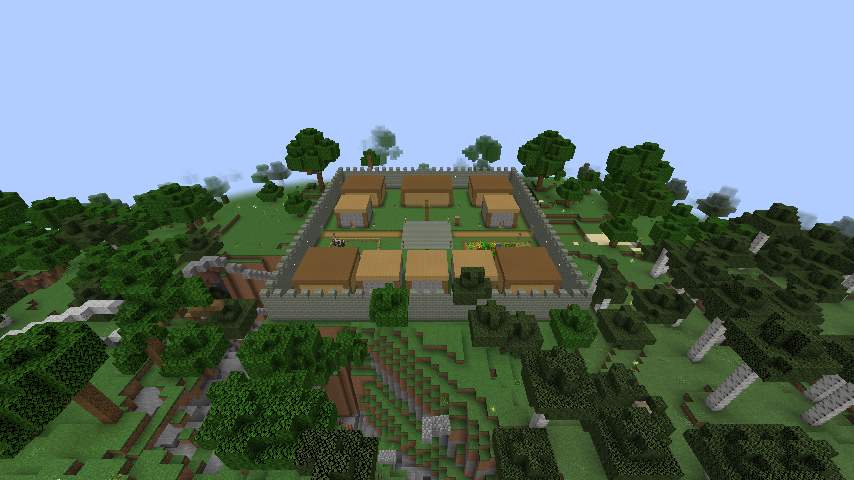
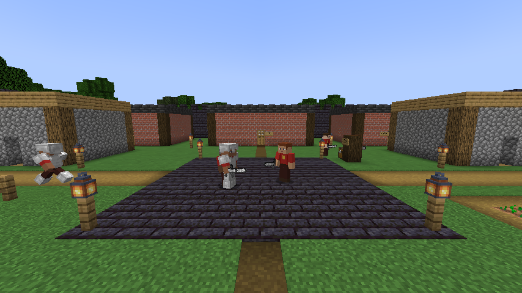
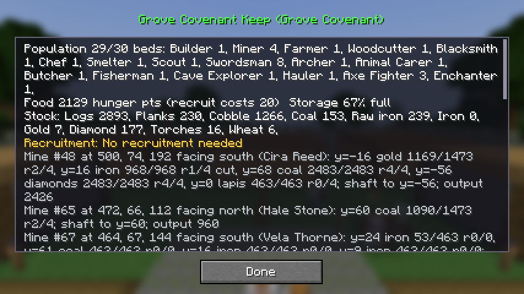
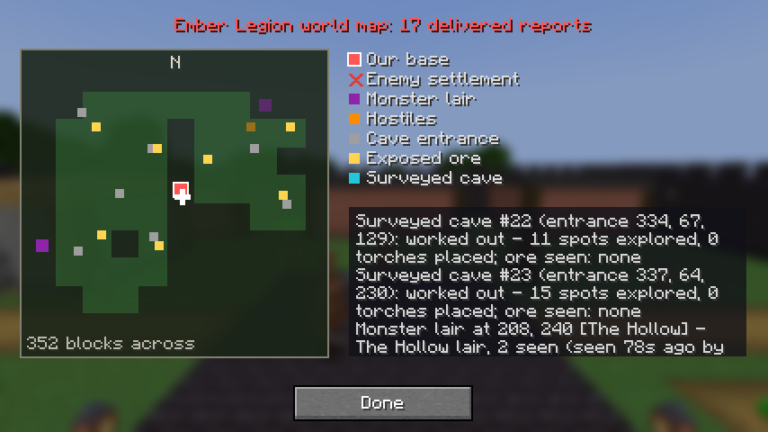

# Faction Clash

An autonomous faction-war simulation mod for **Minecraft Java 1.21.1 / NeoForge 21.1.209 / Java 21**, written
from scratch from the Faction Clash master specification. Four human factions — **Ember Legion, Grove
Covenant, Tide Alliance, Stoneguard** — and the monster faction **The Hollow** build, mine, farm, scout, recruit,
repair and raid on a bounded campaign map without the player having to manage them.

## Download

**[⬇ Download factionclash-0.1.0.jar](https://github.com/rodrigomb47/test/raw/claude/minecraft-mod-build-9amjyg/download/factionclash-0.1.0.jar)**
(NeoForge 21.1.209, Minecraft 1.21.1 — put it in the `mods` folder of the server and every client)

SHA-256: `6fd855a49cc3626ed5c4791de7bb1aacd54aff96a6e765d44257f7eb2a59374a`

This is the **foundation build** (spec §21 priority order): safe starts, a working central station, useful
starting workers, movement, storage and uninterrupted workspace production first, then recruitment, upgrades,
construction, scouting, combat, levels and raids. **Workers do their jobs like players** — miners really dig,
woodcutters really chop, farmers harvest, animal carers breed by feeding, butchers and fishermen work with real
weapons and rods. Several later systems from the spec are not built yet — see [Status](#status) for an honest
breakdown.

## Install

1. Install **NeoForge 21.1.209** for Minecraft **1.21.1** (Java 21) — client and/or server.
2. Put `factionclash-0.1.0.jar` in the `mods` folder (it is needed on both the server and every client).
3. Start the world/server. As an operator run `/fc start` (or `/fc start <radius>`). Preparing a campaign takes
   1–2 minutes of background work; progress is announced in chat and the server keeps running.
4. Players: `/fc join <ember_legion|grove_covenant|tide_alliance|stoneguard>`, then `/fc base` to teleport home.

No other mods are required. Build from source with `./gradlew build` (jar in `build/libs/`).

## Playing

| Command | Who | What |
|---|---|---|
| `/fc start [radius]` | op | Start a new campaign (map centred on world spawn) |
| `/fc status` | all | Which factions still stand; the winner when there is one |
| `/fc join <faction>` / `/fc leave` | all | Join or leave a human faction |
| `/fc base` | member | Teleport to your faction's base (the player teleport; NPCs always travel physically) |
| `/fc info`, `/fc map` | member | Base report and your faction's delivered map knowledge |
| `/fc achievements [faction]` | anyone | The vanilla advancements a faction has made (day, who) and its progress on the long ones |
| `/fc admin dump\|npcs\|info <f>\|spawn <f> <role>\|recruit <f> <role>\|probe <x> <z>\|mine <id>\|blocks <from> <to>\|destroy <id>` | op | Diagnostics, kept separate from player commands |
| `/fc hero list`, `/fc hero info <id>` | all | Heroes (in development: only the test model `test_rig` ships so far): whom each serves, alive or "returns in m:ss", level; one hero's body, size, model and place in the world |
| `/fc admin hero give <id> <faction> [pos]\|release <id>\|revive <id>` | op | A hero joins a faction (beside you, at the position given, or at the faction's base from the console), leaves it, or returns at once after a death |
| `/fc admin hero preview <id> [faction] [pos] [yaw]\|lineup [first] [count] [spacing] [faction]\|preview clear [id]` | op | Screenshot tools: stand display copies of heroes (no AI, cannot be hurt, never part of the campaign), one or a row in front of you facing you; the faction gives the sash colour |
| `/fc admin hero pose <id\|all> mood <mood>\|action <name> [speed]\|base <pose>\|weapon <drawn\|sheathed\|auto>\|phase <n>\|talk\|windup\|blush\|glow <on\|off>\|stop\|clear` | op | Force what a hero's model shows on every loaded copy of it (a mood, an animation at a speed, a walk in place, the drawn weapon, a phase look, the talking mouth...) |

In the world:
* **Reporting Station** (right-click): opens a scrollable screen with population, stock, recruitment decision,
  the mines (each layer's ore, height, progress and lengthening, how deep the shaft goes; worked-out, given-up and
  resting mines), the woodland (trees felled, saplings growing, stumps to replant), the fishing spot (where, open
  or still water, catches - or that water is being looked for or is not within reach), surveyed caves, projects,
  repairs, delivered reports, the villages, outposts and mansions the scouts found, and raids. Only members (and
  ops) see their own faction's records.
* **World Map Board** (right-click): opens a drawn map of the campaign area — explored sectors shaded, your
  bases, and every report your scouts physically delivered as a marker (enemy settlements, lairs, monsters, cave
  entrances, exposed ore, surveyed caves, villages, pillager outposts, woodland mansions; hover a marker for
  details; moving things fade when *stale*), your own position, a legend and the written report list.
* **NPCs** (right-click): a screen with identity, job, equipment, backpack, current task, destination, workplace,
  level and affixes. Sneak + right-click with a better tool, weapon, armour piece or arrow to hand it over — the
  replaced item disappears.
* **Construction sign** next to the staging chest lists what the current project still needs.
* **Faction Heart**: destroy it and the base falls. Members' deliberate edits inside their own base are
  preserved by builders; damage from mobs, explosions or enemies is repaired.

Players respawn at their nearest surviving allied base when they have no bed.

## How the simulation works

* **Gates with doors**: each base wall has a west and an east gate with wooden double doors that players and NPCs
  open to go in and out (monsters cannot open them). NPCs coming home from outside head for the nearest gate;
  NPCs leaving take the gate with the shortest walk to where they are going, and long trips past their own base
  go around its walls.
* **Getting unstuck like a player**: an NPC first gets a small validated hop (≤ 4 across / ≤ 2 up-down by
  default, configurable). If it truly has no way (a sealed cave pocket, the floor of a ravine or pit, a tree
  canopy, the top of a tall trunk or of a bare one-block pillar) it **digs its own way out**, a staircase step by
  step toward its destination's height (or chops the leaves, log or block it stands on), until it can walk again. Where the floor is missing
  (a ravine between it and home) it **builds a bridge** with stone or dirt from its backpack (any solid block it
  carries, such as logs, when it has none), one block per step, rising toward a higher destination; where nothing
  can be dug or bridged (a pit under a settlement's path, or beside a settlement's floor, which may not be dug) it
  **pillars up**. Out in the open below its destination it builds or digs its way up first and only then sideways,
  and it keeps at it until it can really walk on: standing in the open is not enough, a pit a few blocks deep is
  still a dead end. If a whole round of digging finds no way, the next one tries off to one side, then the other.
  Out of blocks on the tip of its own
  bridge, it **walks back** to firm ground (the tip is remembered as a dead end) and digs its way up through the
  rock instead, and it never paces back onto a spot it just left. In a mine stairwell with a step mined away it
  climbs the spiral and **puts the missing stair floor back**. It never digs faction structures, walls, mine stairs,
  containers or anything next to water or lava. A watchdog also catches NPCs that "walk" for 30 s without leaving
  the same spot.
* **Keeping out of pits**: long walks never aim at the floor of a ravine (a waypoint far below both ends of the
  trip is replaced by one off to the side), and a path that only leads down into one is not followed: the NPC goes
  round. New bases also slope the ground beside their walls when a ravine runs right along them. Miners walk long
  mine levels stretch by stretch along their own tunnels, so a far tunnel face no longer sends them up the stairs and
  over the surface.
* **Starting bases** are placed on dry, gentle land: each faction searches its own map sector on real generated
  terrain, widens to the whole map (and a 1.5× map) if needed, and levels the footprint: the walled base, a grove
  pad outside the west gate and a 10-block landing with a path outside the east gate, all sloped into the ground
  around them. Every base starts with a finished reporting station, map board, faction heart, categorised storage
  (food, raw, building, tools, weapons, armour, special, general), workshop (crafting table, 2 furnaces, smoker,
  anvil, enchanting table with bookshelves), 10 beds, a farm, a pen with 2 cows and 2 pigs, walls with gates,
  lighting, and four oak saplings on the grove pad, two of them already grown. No mine and no fence are built: the
  miner chooses its own mine site and the woodcutter fells the trees around the base. A belt of ground beside the
  walls (out to 58 blocks west and 78 east of the centre) is kept loaded and ticking, so the grove grows and nearby
  mines keep working without players. Starter supplies are finite and granted once (saved flag).
* **Ten starting NPCs**: builder, miner, farmer, woodcutter, blacksmith, chef, scout and three swordsmen. Animal
  carers, butchers, smelters, fishermen, cave explorers, extra miners for caves, haulers and an enchanter are
  recruited when the base needs them and has a bed free. A worker left with nothing to do for half a day (a miner
  with no place to dig a mine, a woodcutter with no trees or saplings, a fisherman with no fishing water) or without
  the tool for its job takes up the job the base needs most instead of a new recruit (keeping its level and traits)
  and hands back its workplace; the faction is told why ("Elsa Wells (Fisherman) has had no fishing rod for half a
  day and becomes a Miner (...)"). When none of a role's workers had anything to do, the base does not hire into
  that role again for two days.
* **Hunger like a player's** (config `survival.hunger`, on by default): every NPC has the vanilla food bar (food,
  saturation, exhaustion). Actions cost what they cost a player (blocks broken, attacks, damage taken, jumps,
  swimming) plus a working day's metabolism (`survival.workExhaustionPerDay`, 30 = about 1.5 bread a day, since
  walking costs a player nothing). NPCs heal only when fed (18+, paid in exhaustion), so wounds after a fight cost
  food; at 0 they starve down to 10 health on Easy, 1 on Normal, and die on Hard. They pack 2 meals at the
  storehouse (3 for soldiers, scouts and explorers who go far), eat the best-fitting safe food below 18 (1.6 s,
  shown in the off hand; rotten flesh only when starving) and go home to eat when out of food. Badly hurt, they
  eat even a meal that does not fit and fetch food (two extra meals) to get back over 18 and heal before working on.
  Golden apples stay for fights. With hunger off, NPCs regenerate slowly as before.
* **Faction achievements**: each faction makes the **vanilla advancements** (the game's own names, descriptions
  and requirements) through what its NPCs do the way a player would: Stone Age, Getting an Upgrade, Acquire
  Hardware, Suit Up, Isn't It Iron Pick, Diamonds!, Cover Me with Diamonds, Enchanter, Not Today, Thank You (a
  shield stopping an arrow), Husbandry and A Balanced Diet (what they eat), A Seedy Place, The Parrots and the Bats
  and Two by Two (breeding in the pen), Fishy Business, Adventure, Monster Hunter, Monsters Hunted, Take Aim, Ol'
  Betsy, Sniper Duel, Adventuring Time (biomes its NPCs reach) and more. A faction player's own advancements count
  for the faction too. Each one is announced in chat in the vanilla wording ("Ember Legion has made the advancement
  [Diamonds!]", with the hover text) and who made it. Config `[achievements]`: `enabled`, `announce`, and
  `grantToFactionPlayers` (off by default) to also hand the faction's advancements to its players.
* **Logistics**: each base's quartermaster samples food, wood, stone, iron, fuel and diamonds every minute and keeps
  the trend per day and how long each lasts (station screen). The faction is told in chat when food, wood or fuel
  runs short and when it recovers. Short of food (under a day's meals for its people, or gone within 1.5 days) a
  base **rations**: one meal carried each and only food producers recruited, until it has 1.5 days again; and
  recruitment always keeps a day's meals for the people already there. The hauler keeps the workshop furnaces and
  smoker stocked with coal or charcoal. Cooks with no coal craft logs into planks before burning them (four times
  the smelting per log); cooks keep 16 logs back for building and crafting, and the charcoal-making smelter 24.
* **Combat behaviour**: melee soldiers jump and strike on the way down for a player's **critical hit** (×1.5); a
  sword hit on the ground **sweeps** enemies next to the target (Sweeping Edge applies; never allies or animals).
  Swordsmen carry a **shield**, raised while closing on archers and between swings, lowered to strike; it wears,
  and an axe knocks it aside for 5 s. Archers **back away** from melee enemies and **focus** the enemy closest to
  falling. A badly wounded soldier with no golden apple **falls back** toward home, eats, and returns when healed.
  **A target they cannot walk up to** is handled like a player would: soldiers open **fence gates** (closing them
  behind them so the animals stay in) and doors, **break a block in the way** that is not part of any faction's
  buildings (a raider's dirt in a broken doorway; never a planned wall, door or fence, never the ground of a base, and
  in their own base only what an enemy player put there), **build themselves up** a block or two with the dirt they
  carry or **break the block under** a player standing on a pillar. When there is no way they **stay out of the
  player's reach**, watching from near the way out, call the **archers**, and go in as soon as a way opens. A
  soldier that takes a few blows it cannot answer (a player in a 1x1 hole, just behind a fence, or putting back the
  block it breaks) backs off and does not walk up to that spot again; shot at while it waits, it **takes cover**.
  A soldier shut in a **pit** with the player hitting it from the edge builds itself out with its blocks (filling the
  hole) or, with none, gets out by the stuck recovery instead of standing there. Blocks a player of **no faction** puts
  in a base count as an intruder's too. After a fight in a pen they walk out through the gate, however long the fight,
  and a door a raider broke is put back even when the storehouse has none (the builder crafts one). A player pressed
  against a pen's far fence is reached **through the gate**, not from outside the fence. Guards waiting on a monster
  they cannot get at (one in a cave under the yard) **turn to an intruder** in sight and give the monster up. Workers
  step out of reach instead of fighting; a wounded worker shut in a pit with its attacker hops out.
  Raids **muster** at a rally point outside the target and go in together; a party that loses more than half
  **retreats**. A **war council** picks the target: of the bases its scouts reported, the weakest garrison first,
  then the nearest. The raid party is every soldier beyond a third of the garrison (at least `raidPartySize`), and
  it only goes when it is at least two thirds of the defenders' strength, weighed by arms and armour (a soldier in
  diamond with a diamond sword counts almost three times one in leather with a stone sword); a beaten enemy
  outnumbered 3 to 2 is **counter-attacked** sooner.
* **Pacts against a conqueror** (config `war.pacts`): when a human faction conquers another and two or more human
  factions survive besides it, they swear a pact against the conqueror (announced in chat). Members stop fighting
  each other (no targeting, sweeps, friendly fire or base alarms between them; raids between them are called off),
  the fallen faction's survivors tell them where the conqueror's bases are, they raid only the conqueror, and a
  member joins an offensive another member has launched when their parties together are strong enough. The pact
  ends when the conqueror falls or fewer than two members are left; the next conquest can raise a new one. Shown in
  `/fc status` and the base information screen.
* **Traders and villages**: scouts report villages - any village they come within sight of (plains, desert,
  savanna, snowy, taiga, abandoned ones too), with the villagers with a trade they saw there, or two or more such
  villagers met elsewhere. A base of 14 or more people with a village with traders within 320 blocks hires a
  **trader**; an abandoned village is on the map but no trader goes there. By day, at most every half day, it packs the base's surplus
  (crops, sticks, string, leather, rotten flesh, stone, coal above the reserves — after the first visit, only what
  that village buys) and the stored emeralds, walks to the village and trades with each villager **as a player
  does**: the villager's own offers, prices (with demand) and stock, paid from its backpack. It sells for emeralds
  first, then buys iron or better armour, weapons, tools, bows and crossbows that beat the storehouse's best of that
  kind (bread when the base is rationing), and brings everything home with a summary in chat. Villagers gain trading
  experience and unlock their next offers; their orbs go to the faction's experience. The first trade makes **What
  a Deal!**.
* **Gear wears like a player's** (config `survival.toolWear`, on by default): tools lose durability per block
  they actually speed up (swords 2; like a player switching to an empty hand, an axe is not worn on leaves nor a
  sword on stone), weapons per hit (tools 2), bows and crossbows per shot, armour per hit taken, rods per catch, hoes
  per till; Unbreaking works; items break. Workers swap worn gear (under 25%) for fresh at the storehouse, miners
  carry a spare pickaxe, and a worker whose tool broke takes a spare or fetches a new one; woodcutters, farmers and
  builders work by hand meanwhile (a woodcutter with no axe punches trees, which is how the wood for an axe comes).
  The blacksmith makes replacements (iron, else stone, else wood, so a base is never locked out) and repairs good
  gear at the **anvil with the vanilla rules** (a quarter per material unit, levels = units + prior work, "Too
  Expensive" at 40), paid from the faction's experience; the anvil chips and breaks and a new one is forged.
  Archers hold one arrow that is never used up (tipped/spectral effects apply to every shot, and shots cannot be
  picked up).
* **Workers work like players.** Nothing is produced by a timer or a loot roll: every item comes from a block a
  worker really broke, an animal it really bred or killed, or a vanilla loot table a player would also roll.
  * Breaking uses the player formula (tool speed, Efficiency, Haste, underwater and in-air penalties, ×30 with the
    right tool, ×100 without), shows the crack animation, and gives the block's own loot only when the tool can
    harvest it (a wooden pickaxe gets nothing from iron ore). What a miner, woodcutter or farmer breaks goes
    straight into its backpack, as a player's mined blocks go into the inventory; only what does not fit (or junk
    a miner no longer wants) drops at its feet. Things that fall on their own (decaying leaves, eggs, wool) are
    walked over and picked up.
  * Output goes into the worker's backpack and is carried to storage; full storage pauses work without deleting
    anything.
* **Mines** are sited and dug by the miners, as a player would. A miner with no open mine of its base to work and
  no surveyed cave looks for a place to dig one within `mineSiteRadius` (64) of the base centre, on ground already
  loaded: more than 8 blocks beyond every base's walls, out of other factions' land, 48 blocks from the villages,
  pillager outposts and woodland mansions its scouts reported and 24 from every other mine's mouth; firm, nearly
  level ground deep enough for a mine, with no water, lava or built blocks around the mouth; and room for the
  tunnels to run away from the base without coming near walls, other bases, lairs, other mines' tunnels or the map
  edge. Of those it takes the shortest walk from a gate, weighed against water over the tunnels, ground dipping
  toward them, uneven or sandy ground at the mouth and less room to lengthen the tunnels. Finding nothing, it walks
  out to four points around the base to look there, then looks again every few minutes. A base works at most
  `maxOpenMines` (3) mines at once. There is no hut: the miner sets a torch by the mouth, plugs the ground around
  it and digs an open 2×2 spiral staircase (one step down per block, a torch every 8 steps), plugging water, lava
  and loose sand beside each step and digging on through aquifers.
* **Mine layers** follow what the base needs and the pickaxe in hand, at the heights where vanilla ore is richest:
  coal 6 blocks under the surface (any pickaxe), iron at y=16 and lapis at y=0 (stone or better), gold at y=−16 and
  diamonds and redstone at y=−56 (iron or better). Iron comes first when the storehouse is nearly out, then
  diamonds, then more iron, coal while fuel or wood runs short, gold, and lapis once there is an enchanting table.
  The miner finishes a layer before it switches, uses a layer already near the wanted height, and opens a new one
  at least 6 steps from every other, digging the spiral down to it first. Each layer is a **branch mine** (a
  40-block main tunnel with 10-block side branches every 4 blocks, torches every 8 blocks); a finished layer is
  lengthened 40 blocks further, up to 4 times, where its tunnels have room, and a mine with little room digs more
  layers of the same ore a little above or below instead. When only a better pickaxe would help, the mine
  **rests** until the blacksmith has made one (the miner fetches it, or looks for another site meanwhile); when
  every layer it can reach is dug, the mine is **worked out** and its miner moves on to a cave or a new site.
* **Two miners can share a mine.** While every mine site of the base is taken (or no site can be found), a miner
  without a mine **helps** in an open mine of its base instead of standing idle: one with a miner of its own, no
  helper yet and its stairs dug. It takes another level of it by the same rules (the ore the base lacks most that
  its pickaxe can harvest): an unfinished level, one to lengthen, or a new branch mine where the stairs already
  pass. It never works the holder's level or one within 3 steps of it, and never digs the shaft, so the two never
  dig the same cells; the holder goes on planning the mine and digging the shaft deeper, both use the same stairs,
  and neither follows an ore vein into the other's level. A holder whose only work left is the helper's level
  waits for it rather than calling the mine worked out. The helper leaves (climbing out first) when its level is
  done or cut, when the mine is set aside or rests, or when it gets a mine or cave of its own; it takes the mine
  over when its miner dies or is retrained. The station's mine line names it ("helped by ... on y=..."). Helping
  is no reason to hire miners, and a helper with no mine of its own for half a day counts as a spare hand: the
  base may retrain it for a role it needs, as it did idle miners.
  Miners follow exposed ore veins, plug water, lava and loose sand before opening a cell (or dig through falling
  sand like a player), clear flooded tunnel cells, bridge cave holes in the tunnel floor, stop a branch where it
  breaks out of a hillside, and stop collecting cobblestone-type junk once storage holds 512 of it. They never dig
  block entities, built blocks (bricks, polished and tiled stone: dungeons, strongholds, trial chambers, ancient
  cities), another mine's stairs, the deep dark, the ground under a base or other factions' land: a tunnel that
  meets one ends there, and a shaft that meets one (or stays stuck) stops above it. A mine whose mouth cannot be
  reached, whose stairs stay blocked or whose shaft cannot get 6 steps down is given up, and its miner never picks
  that site again. Stair steps whose floor was dug away are repaired with stone from the miner's backpack.
* **Woodland**: there is no tree plot and no fence. Woodcutters fell the natural trees within `forestRadius` (64)
  of the base centre (oak, birch, spruce, jungle, acacia, dark oak and cherry, 2×2 trunks too) log by log with
  their axe from the top down, cutting high branch ends from the ground under them, break the canopy (the leaves'
  own loot drops saplings, sticks and apples), collect what fell and **replant the same species** at the stump
  (four saplings for a dark oak, and for a mega spruce or giant jungle tree, so it grows back huge; a stump still
  waiting for its sapling after half a day gets another species if one is at hand, and after two days it is
  forgotten). They fell only a whole natural tree: a trunk of 3 or more logs on dirt with natural leaves, touching no
  built block, bee nest or other tree; never by the walls, in other factions' land, by a lair, within 32 blocks of a
  known village or 48 of a known outpost or mansion. **Tall trees** (mega spruces, giant and tall jungle trees, tall
  fancy oaks and birches: any log more than 8 blocks over the stump, up to 32) are felled from a **scaffold**, as a
  player "nerd-poles": the woodcutter fetches up to 32 dirt from the storehouse or, when the storehouse has too little
  (a base on stone), **digs its own**: by hand, or with a shovel it carries, at player speed, it scrapes the top block
  (grass, dirt or podzol, which drop dirt) off a flat patch of open ground near the tree, just what the scaffold
  needs. Every dug cell is one block deep with a block left beside it to step out onto (two rows dug, one left
  standing), never by water, a drop, a tree or a sapling, never twice in the same place, and never by the walls, on
  the road strip, by a mine's mouth, a fishing spot, a stump waiting for its sapling or a grove spot, or in protected
  land; the storehouse's own dirt is left to the builders. Then it chooses a column beside the trunk from which every
  log comes within reach, cuts away the vines in its way (a giant jungle trunk is hung with them), jumps and places a
  block under its feet until the top is in reach, fells the tree top down and clears the canopy within reach (its
  saplings go into the backpack), then breaks the pillar block under its feet one at a time on the way down, the dirt
  going back into its backpack. Up there it ignores fights and is not knocked off; hurt, hungry, with a full backpack
  or at nightfall far out it comes down first, and a reload resumes the pillar exactly. The tree comes down strictly
  from the top, so even a climb cut short leaves no log hanging, and a pillar a woodcutter could not take down itself
  (it died up there) is taken down by the woodland's next woodcutter. With no dirt and no open ground to dig it from
  such trees are left standing, as are mangroves, trees whose branches no single pillar reaches, and trees with any
  log (a branch end too) in protected wood such as the margin by the walls. A woodcutter steps out of a sapling's
  column before its bone meal (or an instant Regrowth) grows the tree, since vanilla grows the trunk into whatever
  stands there. Each base also keeps a **grove** of `groveSize` (16) saplings growing on a lattice in its
  always-ticking belt (birch first, then spruce, oak, cherry, acacia; twice as many while the base is short of
  wood), fetching the saplings from the storehouse and first picking any flowers beside an oak, birch or cherry
  sapling so no bee nest grows. Saplings grow naturally — woodcutters only speed growth up with real bone meal
  (made by the blacksmith from bones). With nothing to fell near home a woodcutter walks 72 blocks out, in one of
  eight directions in turn, to look for trees. Old tree-plot fences are taken down into storage. Between dusk and
  dawn woodcutters and fishermen do not work more than 16 blocks outside the walls (config
  `remoteWorkInDaylightOnly`).
* **Cave explorers** go to cave entrances the scouts reported, find the way in, and explore the cave on foot:
  they light dark spots with real torches, note every ore they can actually see (an exposed face and a clear
  line of sight — nothing behind rock), and build steps with placed cobblestone or dirt down drops of two blocks
  or more so the way stays walkable both ways. They never mine. They turn back when out of torches, wounded,
  attacked or done, and hand the survey (the route walked and the ores seen) in at the reporting station.
* **Cave mining**: a miner with no open mine of its base to work takes a surveyed cave before it looks for a new
  mine site. It walks the explorer's route, mines the marked ores and every ore it uncovers, tunnels a short way to
  ores it cannot otherwise reach, then digs prospecting tunnels from the deepest spot into the cave walls. There is
  no artificial supply limit — the cave holds exactly the ore that is really in it; when it is worked out the miner
  hands it back. Bases take on up to two cave miners.
* **Haulers** (from 12 NPCs on) keep the base tidy: they pick up items lying around inside the walls and re-sort
  the storehouse, carrying stacks from the overflow chest or a wrong chest to the chests of their category.
* **Farmers** harvest ripe crops by breaking them, collect the drops, till, and replant; the first row of the
  farm is a carrot row so the pigs can be bred.
* **Animal carers** go into the pen through the gate (waiting for the animals to move away from it and closing
  it behind them), feed two adults the food their species eats (wheat for cows and sheep, carrots, potatoes or
  beetroot for pigs, seeds for chickens) so vanilla breeding makes a real baby, shear sheep, milk cows with
  buckets, pick up eggs and wool, and lure animals that got out back into the pen by holding their food. Pens
  stop breeding at 8 animals per species.
* **Butchers** kill only surplus adults with real sword hits — never babies, never animals that are breeding,
  and never below 4 breeding adults per species — and collect the meat and leather.
* **Fishermen** fish real water outside the walls with a rod (a pond, lake, river or the sea), never the farm's
  irrigation or any water within 5 blocks of farmland. The fisherman, and the base every few minutes, look within
  `fishingRadius` (64) of the base centre for water at least 2 deep under open sky with at least 25 blocks of
  surface, beyond every base's walls, out of other factions' land and away from lairs and known outposts and
  mansions, with a dry stand on the bank 2–5 blocks from the bobber and 1–2 above the water; open water first, then
  the shortest walk from a gate. The fisherman climbs out onto the stand before it casts and checks the water with
  every cast; when the water is gone or the stand cannot be reached it remembers the spot as unfit and looks for
  other water. With none near the base it walks 72 blocks out in one of eight directions in turn; when a whole
  round finds nothing, the base remembers for two days that it has no fishing water (no fisherman is hired
  meanwhile) and the fisherman waits at the storehouse, to be retrained after half a day. Bites follow vanilla
  timing (100–600 ticks plus 20–80, shortened by Lure, sooner when it rains on the water) and the vanilla fishing
  loot table (Luck of the Sea applies); in open water (vanilla's 5×5, 2-deep, open-sky test) the treasure catches
  can come up as for a player (config `fishingTreasure`). There is no visible bobber entity.
* **Farmer, chef, smelter, blacksmith** use the real farm, smoker, furnaces and crafting recipes. The blacksmith
  crafts batches from real needs of every worker of its base: replacements for worn-out tools, better pickaxes for
  the miners (stone at once, then iron, which opens the gold and diamond layers, and diamond, which only digs
  faster), iron swords, armour and shields
  for soldiers, bows, sticks, bone meal, torches, golden apples, diamond swords when diamonds exist. Furnace and
  smoker workers fetch fuel as soon as any station runs dry (coal, charcoal, a coal block, then logs and planks
  beyond a building reserve); with nothing to burn they wait at the storehouse and say so.
* **Experience and the enchanter**: NPCs pick up experience orbs like players: from ores they mine, from furnaces
  when the output is taken, from animals they breed. The faction's experience goes to its **enchanter**, who works
  the workshop's enchanting table (10 bookshelves) exactly like the vanilla screen: three random offers set by the
  bookshelves, paid with experience levels and 1–3 lapis lazuli. It enchants the best unenchanted iron, diamond or
  netherite weapons, armour and pickaxes and bows in the storehouse (soldiers' gear first); everyone then prefers
  enchanted gear of the same material. Silk Touch tools are kept aside (ore would come out as ore blocks).
* **Recruitment** replaces missing workers and grows the garrison (40% archers by default) up to the number of
  beds; it charges food by normal hunger value plus exactly one equipment payment route. A fisherman is hired only
  where the base has found fishing water or has not looked yet (or last looked two days ago), no miner is hired for
  an open mine or a surveyed cave while one of the base's miners is free to take it up, and a role found barren is
  not hired again for two days.
* **Builders** queue houses (with straw bedrolls made from wheat) and storage expansions, carry materials to the
  staging chest, build bottom-up from saved plans with substitutes for unavailable styled blocks, and repair any
  damaged plan block.
* **Scouts** explore unexplored map sectors, record only what they see and what is worth a trip (enemy
  settlements, lairs, monsters, cave entrances they can see a way into, exposed ore, villages, pillager outposts
  and woodland mansions — not trees or water, which are easy to find), and publish by reaching the station.
  Monsters do not end a trip: the scout steps aside to firm ground 12-20 blocks away, clear of them and on the
  side of where it is going, and carries on; it retreats home along a fixed route from enemy soldiers, or from
  monsters only when badly hurt, hit again and again or unable to shake or get past them. Known pillager outposts and
  woodland mansions are dangerous ground: no exploration target, mine, tree, fishing spot or travel waypoint lies
  within 48 blocks of one. Once
  everything within `scoutRange` is explored and no living rival settlement is known, they push the frontier out
  64 blocks at a time, up to the edge of the map, so distant factions find each other.
* **Soldiers**: swordsmen, axe fighters, archers and crossbowmen. The held weapon sets the real attack speed and
  damage (an axe hits harder and knocks shields down; so far every weapon swings every 20 ticks, see BALANCE);
  crossbows charge for their real charge time and fire faster, straighter bolts a little farther than bows.
  Every third melee recruit carries an axe, and every third ranged recruit a crossbow when one can be paid for.
* **War**: guards patrol, pick up loot and answer a base defence alarm; hostile vanilla mobs hunt NPCs; zombies
  and skeletons do half damage to NPCs; wounded civilians flee and call guards; NPCs jump back from priming
  creepers. Factions raid targets their scouts reported, keeping home defenders; raiders travel physically, break
  the target's heart, loot its storage and carry it home. Hollow lairs grow and raid nearby settlements.
* **Levels**: completed work earns XP for the NPC that did it; every level grants one capped affix (e.g. faster
  digging, instant sapling regrowth); reloads never re-stack bonuses. Affixes for the newer systems: **Thrifty**
  (gear wears less), **Hardy** (hunger drains slower), **Duelist** (stronger critical hits, melee soldiers),
  **Angler** (a second catch, fishermen) and **Haggler** (lower villager prices, traders).
* **Background simulation** is bounded: base areas and travelling NPCs hold ticking chunk tickets, so factions
  progress away from players without loading the whole map.

All numbers that the spec left open are documented as proposals in [BALANCE.md](BALANCE.md) and most are
configurable.

### Config file

The config is **not** part of this repository: NeoForge creates `config/factionclash-common.toml` inside your
Minecraft instance (or server) folder the first time the game starts with the mod. Edit that file while the game
is closed. A copy with the default values is in [docs/factionclash-common.toml](docs/factionclash-common.toml)
for reference; you can also place it in your `config` folder before the first launch.

## Status

Legend — **U** unit test, **G** in-game GameTest (headless server), **S** observed in the multi-day dedicated
server simulation, **V** seen on a real client (the Xvfb viewer joined to a dedicated server), **—** implemented but
not separately verified, **✗** not implemented.

| Spec area | State | Verified |
|---|---|---|
| §1 Factions, bounded map, join/teleport/respawn, last-faction-standing victory | Implemented (victory rule proposed: faction heart) | S (bases destroyed, a faction eliminated); player join/respawn — (no client was connected) |
| §2 No hunger, nutrition-weighted recruitment, no gear wear, equipment cost, one arrow, finished station at start | Implemented; hunger and gear wear were added later and are on by default (`survival.hunger`, `survival.toolWear` off restore the spec's rule) | U, G, S |
| §2/§16 Great People (HSR/ZZZ characters), starter hero, 10-minute revival | In development as original heroes (`docs/heroes-v2/`): the hero entity with the test model, given by an operator; it counts as a soldier of its role but is never drafted into a raid, fights with that role's basic attacks, keeps one entity per hero, saves, and returns 10 minutes after a death. Its model is animated (idle, walk, run, the katana swing, work clips) with a face that blinks, talks and shows 12 moods, a sash in its faction's colour, glowing phase looks, tools in its hands and less detail far away. Kits, boss fights and hero-led factions are still to come | U (size, synced fields, revival, face, clips, LOD, sway, mood, timings), G (files, fields, size, raids, uniqueness, a fight, saving, death and return, look, previews, poses, fight flags), S (a dedicated server: give, fight, restart), V (the Xvfb viewer: idle, walk, swing, blink, moods, talk, sash, tools, phase look, LOD) |
| §3 Safe starting bases, roster, supplies once, animals, enchanting setup | Implemented | S (incl. save/reload) |
| §4 Roles: builder, miner, farmer, woodcutter, blacksmith, chef, smelter, scout, swordsman, archer | Implemented | S |
| §4 Roles: animal carer, butcher, fisherman | Implemented (player-like) | G (breeding, culling rules), S |
| §4 Roles: cave explorer, hauler/quartermaster | Implemented | U (survey rules), G (ore sight, torches, sorting), S |
| §4 Roles: crossbowman, axe fighter | Implemented | G (crossbow fire, weapon attack speed) |
| §4 Roles: enchanter | Implemented (vanilla table, real experience from orbs, lapis) | G (table, levels and lapis paid; ore experience reaches the faction; gear choice), S |
| §4 Roles: field medic, TNT expert, rail engineer | ✗ not implemented | — |
| §5–6 Workspaces, mines dug by the miner (spiral shaft, branch mine, tier levels, pickaxe-gated drops) | Implemented (player-like; instead of a fixed hut mine with tiers, each miner chooses its own site and its layers by need and pickaxe) | U (geometry, layer planner, site rules, old-mine migration), G (break times, drops, own shaft and ground ring, aquifers, protected blocks, resting and given-up mines), S |
| §7 Natural cave mining | Implemented (surveyed by explorers, mined by miners; depletion is real ore running out) | U, G, S |
| §8 Tree plots + upgrades, farm, chef | Implemented differently: no plot, fence or upgrades - woodcutters fell and replant the natural trees around the base and keep a grove (player-like woodcutting and farming) | U (tree shape, replanting, grove rules), G (felling and replanting, protected wood, old fences, reloads, grove), S |
| §8 Pens/breeding/butchering, fishing | Implemented (fishing on real water outside the walls, never the farm's irrigation) | U (water and stand rules), G, S |
| §9 Golden apples used by NPCs | Implemented (soldiers carry one; eaten when badly hurt in a fight; blacksmith crafts them) | G |
| §10 Categorised storage, blacksmith batches, soldier armour priority, hauler | Implemented | G (storage, hauler), S |
| §11 Builder projects, staging chest + signs, repairs, player-edit preservation | Implemented (houses, storage expansion) | S |
| §11 Perimeter expansion, outposts, procedural building variety | ✗ | — |
| §12 Scouts, reports, map board, stale sightings, retreat, overdue follow-up | Implemented (chat-based map; villages, pillager outposts and woodland mansions; scouts step aside from monsters, retreating home only when badly hurt or unable to shake them, and from enemy soldiers) | U (escape routes, structure rules), G (stepping aside, retreats, structure sightings), S (before villages, outposts, mansions and stepping aside) |
| §12 Radio / communication tower | ✗ | — |
| §13 Player-equivalent speed, allies pass through each other, stuck recovery (default ≤4 across / ≤2 up-down, configurable), day/night continuity | Implemented | G (4.25 blocks/s; recovery), U, S |
| §14 Mob targeting, half undead damage, civilian flee, creeper jump-back, raids, defence alarm | Implemented | G, S |
| §14 Soldiers against targets they cannot walk up to (gates, breaking players' blocks, building up, waiting out of reach, calling archers, no blows taken twice from one spot, cover, out of a pit) | Implemented | U (reach planner), G (pen, doorway, pillars, waiting, a hole, a pit, a re-blocked doorway, leaving the pen after a long fight, cover, workers, break rules, outsiders' blocks, door repair, a player against a pen's far fence, guards turning from a monster to an intruder, a wounded worker in a pit); **checked live** twice on a dedicated server with a real client as the player (pen, far side of a pen, doorway, 2-high pillar, 1x1 hole and pit); not yet in a multi-day campaign with a real player |
| §14 Field medics, potions | ✗ | — |
| §15 Overworld/Nether dungeons, Nether expeditions, TNT, rails | ✗ (Hollow lairs are the only monster bases) | — |
| §17 Boss reward chests and hero tokens | ✗ | — |
| §18 Work XP, levels, random capped affixes, no re-stacking | Implemented | U, G, S |
| §19 Inspection, station/map info, signs | Implemented (station, map board and NPC screens) | S; screens checked in a real client |
| §20 Persistence, bounded background simulation, no duplication on reload | Implemented (campaigns saved by earlier versions load and convert) | G (incl. old-format mines, tree plots and fishing spots), S (restart comparison) |

Graphical check: a real 1.21.1 client (software OpenGL on a virtual display) joined the test server with the
mod and rendered the bases, blocks, NPC skins, armour and held items, and opened the station and map board
screens (screenshots below; the screens were opened with `/fc info` and `/fc map`, which send the same screens
as right-clicking the blocks). No interactive play session by a human player was performed.

Grove Covenant's base on day 16 of a campaign with this version: no fenced plot or mine hut any more; the woodland
the woodcutter fells and replants grows all around the walls, and the miners' own shafts lie outside them.

The reporting station and world map board screens of the same base, captured in the same real client. The station
lists each self-chosen mine with its layers (height, ore, progress, lengthening rounds) and how deep its shaft goes;
the map legend has the village, pillager outpost and woodland mansion markers scouts now report:

## Testing

* `./gradlew test` — 233 JUnit tests for the pure rules (a hero's hitbox from its model, its synced fields and revival time,
  its face (which frame each plane shows, blink timing, the talking mouth, the mood hold), which animation clip plays
  (a teleport is not running), the form-scaled animation keys' variable,
  the level of detail by distance, the chain sway, its mood, and the animation timing files; how a soldier reaches a target it cannot walk up to: break,
  build up, undermine or nothing; spiral mine and branch-mine geometry, the mine layer
  planner and the level a helper takes in a shared mine, mine site rules and corridors, the migration of old hut mines, tree shapes and the felling rule, the
  scaffold pillar's column and height for tall trees, the dirt patches a woodcutter digs for one (one block deep, a
  step out from every cell, never beside water, a drop or an earlier patch), branch ends in protected wood, replanting (2x2 for mega spruces and jungle trees) and the grove, fishing water and stand rules including vanilla's open-water test, work zones, scouts'
  escape routes and structure sightings, cave survey walk graph, vanilla experience levels, the vanilla food bar,
  the logistics ledger, food payment, affix caps, XP curve, stuck-recovery selection, scout rules).
* `./gradlew runGameTestServer` — 149 GameTests on a real headless server, including **heroes** (the shipped hero files load; a hero's synced fields, hitbox and its 1.98 cap; never drafted into a raid party; one entity per hero; it fights, saves and reloads, falls and returns; its look and timings load; a preview copy is never the campaign's hero; a pose drives the synced fields and a played swing is cleared after its clip; fighting draws the weapon and sets the mood), **soldiers against a player
  they cannot reach** (open a pen's gate and close it behind them with the cow still in, and walk out through it after
  the fight, also after a fight longer than the gate memory; break a player's block in a broken doorway and never the
  wall, and go straight in once it is broken, but not again and again when the player puts it back; break the block
  under a player on a pillar, build themselves up beside a perch they may not break,
  hit a player one block up without breaking anything, wait out of the player's reach and call the archer when there
  is no way in, then go in once there is; take only a few blows from a player in a 1x1 hole, then keep away; get out
  of a pit in their own yard with the player at the edge, by building up or by the stuck recovery; take
  cover when shot at while waiting; a worker steps out of reach; what a fighter or an ally may break and build, and
  that a factionless player's blocks in a base are its soldiers' to break; a broken door put back with no door in
  the storehouse; go round through the gate to a player pressed against the pen's far fence; a guard waiting on a
  monster it cannot get at turns to an intruder, and lets go of one it can neither see nor reach; a wounded worker
  shut in a pit with the player gets out), **miners** (digs its own
  shaft and plugs the ground ring around the mouth, digs on through an aquifer and clears a flooded tunnel, goes on
  down a half-dug shaft, never digs protected blocks, finds no site on shallow ground, fetches a better pickaxe for
  a resting mine; a mine set aside keeps only the ground it dug; a second miner helps in a mine at the cap on
  another level with no shared cell, through a reload, leaves a mine that is set aside and takes over one whose
  miner died), **woodcutters** (fells a tree and replants the same
  species, leaves built and protected wood alone, takes down an old fence, resumes a tree after a reload, cuts a
  branch end from below, leaves an unreachable tree for a while, fills the grove from the storehouse and picks the
  flowers first; fells a mega spruce and a tall jungle tree from a dirt scaffold and leaves no log or block behind,
  replants the spruce as a square of four, resumes its scaffold after reloads, comes down it for food, digs its own
  dirt from open grass (one block deep, a step out from every cell, never in the places kept from digging, with a
  shovel it carries) and fells the tall tree with it, digs elsewhere when it cannot get to a patch, leaves tall trees
  alone with no dirt and no ground to dig, leaves
  no log hanging when a climb is cut short, takes down a pillar a dead woodcutter
  left, builds its pillar through a trunk's vines, fells three vanilla giant jungle trees grown from the real feature,
  leaves a tree whose branch end lies by the walls, steps out of a sapling's way before it grows; any NPC left on a
  bare pillar breaks its way down), **fishermen** (never picks farm irrigation, catches at a pond, leaves when the water is gone,
  climbs onto the bank before casting, treasure only in open water, no fisherman hired without water),
  **retraining** (frees the workplace, barren roles, a worker with its tool again is not toolless), **old saves**
  (old mines, tree plots and fishing spots load and convert), **scouts** (walk on past a drowned in a pond, step aside from zombies and keep
  exploring, walk on past a monster that cannot see them, retreat when badly hurt or from enemy soldiers, find
  villages and outposts through loaded chunks only), **faction advancements**
  (single, any-of and all-of requirements; an NPC's diamond makes Diamonds!), **rationing** on and off,
  **critical hits and sweeps**, **shields** (up against an archer, an axe knocks it aside), **wounded withdrawal and
  archer kiting**, **gear wear** (sword per hit,
  armour per hit taken, pickaxe per block, a used-up pickaxe breaking), **hunger** (a hungry NPC eats its bread, not
  rotten flesh, unless starving; only a fed NPC heals), **anvil repair rules** (and no new axe for a woodcutter whose
  axe is only put away while it digs), **digging out** (sealed in
  rock it climbs out by a staircase; on a canopy or a tall trunk it chops its way down; just above its goal it digs
  down; a gap is bridged with exactly one block per step; a miner in a pit beside a settlement's protected floor and
  wall builds itself up beside the edge and walks round to the storehouse), the **enchanter** at a real table (levels and lapis paid,
  nothing without experience), **ore experience** reaching the faction, enchanted-gear choice (Silk Touch loses),
  a cold furnace sending its worker for fuel, cave explorers seeing only visible ore and placing real torches, haulers sorting the storehouse,
  crossbow charging, player attack speeds, golden apples and mined blocks going into the backpack, plus: walking speed, no gear wear, half
  undead damage only, no friendly fire, one-arrow ranged attacks with effects, save/reload without affix
  stacking, local stuck recovery, creeper jump-back, mob targeting, full storage never deletes items,
  recruitment payment routes, guards engaging enemies, defence alarm, **player break times** (stone pickaxe on
  stone 12 ticks, iron 8, bare hand 150), **real drops and pickup** (a wooden pickaxe gets nothing from iron
  ore), **breeding by feeding** (two fed cows make a calf; babies can't be fed to breed) and **butcher rules**
  (babies and the breeding stock are spared).
* `tools/sim.py` + `tools/rcon.py` drive a real NeoForge dedicated server over RCON (`/tick sprint`) and print a
  per-day summary of every faction (see the source for usage).

### Dedicated-server simulation results (installed jar, NeoForge 21.1.209, fixed seed)

**Pits and long mine walks (a 15-day campaign, continued from day 15 with the fixes):** two Grove miners had sat
for 8 and 2 days in a hole they had dug into the pad beside the south wall, at the bottom of a 20-block ravine
that runs along it, and a woodcutter had joined them. All three climbed out (pillaring up beside the pad's edge)
and were at the storehouse about 1,000 ticks after the server started, then went back to work. A miner whose tunnel
face lay 73 blocks out along an aquifer had paced at its mine's landing (257 recoveries in a day); it now walks
the tunnel in stretches. Over the next full day the stuck-recovery count of all NPCs fell from 592 to 97, and Grove
brought in 204 raw iron instead of 128 and 96 coal instead of none. A fresh campaign with the same seed now slopes
the ground beside that wall down to the ravine instead of leaving a 20-block drop, and had 199 recoveries after two
days (274 in the run below). Notes: `docs/design/notes/stuck-pits.md`.

**Tall trees in a fresh campaign** (same seed, 14 days; 21 trees grown by hand with `/place feature` 28 to 51 blocks
from a base centre, 17 of them taller than 8):
* 13 of the hand-grown tall trees (mega spruces and pines of 77 to 101 logs, giant jungle trees of 57 to 109, tall
  jungle trees, a fancy oak, a super birch) were felled from dirt pillars 3 to 17 high. No log and no dirt was left,
  and the 2x2 stumps got four saplings each. Those squares grew back into mega trees (bone meal) and were felled
  again: over days 7 to 13, 29 trees taller than 8 were felled from pillars 1 to 19 high (2,109 logs). Every pillar
  came down normally. No woodcutter fell or was hurt up there.
* A base with no dirt left its three tall trees alone for 28,000 ticks, then felled them once given 64 dirt. A
  server restart with a woodcutter 10 blocks up resumed the same pillar.
* Ember Legion's logs in store rose from 2,517 to 3,868 in four days; 4.8 to 5.8 ms per tick.
* Three faults were found and fixed. Vines on giant jungle trunks stopped the climb. A branch end in the margin by the
  walls was left hanging after a felling. A woodcutter standing half in a sapling's column suffocated when an instant
  Regrowth grew the tree.
* One giant jungle tree lost its trunk below its crown with no woodcutter near it (probably fire; still being looked
  into).

**The final check: a fresh campaign with every fix, the east landing and the new scouts** (same seed, eight days,
default config; the drowned rule for scouts came after it):
* **Mines**: 11 mines, every one on a site its miner chose, and no shaft stopped early. Shafts went down through
  aquifers to the diamond layer (y=−54 to −56) at every base. Miners took iron at y=14 to 16, coal near the surface,
  lapis and gold where the stock called for them, and mines whose tunnels could not be lengthened opened extra iron
  layers nearby (y=9, 16 and 23 at Stoneguard).
* **Wood**: the woodcutters felled 247 (Stoneguard), 227 (Grove), 224 (Ember) and 104 (Tide) trees. Tide's base
  stands on the sparse ground where the run below felled only 25 trees in ten days.
* **Fishing**: all four bases fished real water beyond their walls, two in open water; Tide made 357 catches.
* **Scouts**: 173 expeditions. On 23 of them scouts stepped aside from monsters and went on exploring, and 12 ended
  early because of monsters, five of them because of drowned along rivers. On one trip a scout stepped aside 229
  times from drowned swimming by the shore, which led to the drowned rule and the cap of 40 per trip. Tide's scout reported a plains village 8 blocks from its real centre, with 2 traders. The map holds no outpost
  or mansion (the nearest lie 1,300 and 3,700 blocks out), so a scout was set down beside an outpost by hand: it
  reported it, and its base's station listed "pillager outpost 1324 blocks S (keep away)".
* **War**: Ember Legion and Grove Covenant had fallen by day 8, and one of the two Hollow lairs.
* **Performance**: 4.6 to 10.4 ms per tick over the sprints (the busiest days of the war).

**A fresh campaign with the worker redesign** (same seed, ten days, run before the last round of review fixes,
which came out of it, and before the scouts' villages, outposts, mansions and stepping aside):
* **Mines**: every faction's miners chose their own sites outside the walls and dug their own shafts. Ember Legion
  (six miners by day 10) opened five mines with layers at about y=58 to 69 (coal), 14 to 16 (iron), −2 to 0
  (lapis), −16 to −18 (gold) and −54 to −56 (diamonds), worked two of them out, and had 118 diamonds, 389 raw iron
  and 1,092 redstone in store. One of Grove Covenant's shafts stopped at y=42 in an aquifer (fixed: miners now dig
  on through aquifers).
* **Wood**: Ember's woodcutter felled 422 trees (2,063 logs in store on day 10), Tide's 175. Grove's felled only 25
  and its logs ran out: foraging far out, it gave up its own grove trees as unreachable and never fetched the grove
  saplings waiting in storage (fixed: such trees are walked back to and only left for a while, the grove is filled
  from the storehouse, and the grove default went from 8 to 16 saplings).
* **Fishing**: every base found real water beyond its walls (three of the four in open water), none within 8
  blocks of farmland; Tide's fisherman made 160 catches, Ember's 128.
* **Stuck NPCs**: Stoneguard's east gate opened onto a one-block ledge four blocks above a lake, where four NPCs
  were stuck for days (fixed: new bases level a landing outside the east gate).
* **War**: by day 10 both Hollow lairs were destroyed and Tide Alliance and Stoneguard had fallen.

The runs below are **historical**: they used the old layout (a hut mine with fixed tiers, a fenced tree plot,
fishermen at the farm's water channel), which new campaigns no longer have, so the same seed does not reproduce
them.

**Long campaign with an earlier version** — one world, nothing spawned by hand, run to **day 21.6** with about a dozen
server restarts (each one also tested save/reload) while fixes were rolled in:
* **War**: Ember Legion raided The Hollow from day 5; both monster lairs were destroyed by day 11, eliminating The
  Hollow. Ember went on to raid Grove Covenant (11 raids in all). Grove launched its first raid on day ~21. No
  winner yet: the four human factions were all alive with 14–28 NPCs each.
* **Mines**: every faction's mine reached tier 4 (y = −48) and all its infill levels. Once fully worked out (around
  day 12), miners started **lengthening** the branch mines and found new deepslate diamond and iron veins (Grove
  went from 3 to 24 diamonds in two days). Mine output by day 21: Tide 9,600 blocks, Ember 6,700, Stoneguard 5,000
  (its mine lies under a lake and was stuck for 11 days until the dig-out fix, then reached tier 4 and 45 diamonds
  in four days), Grove 4,800.
* **Caves**: explorers surveyed 47 caves (most had no visible ore); cave miners worked 13 of them, mining about
  1,900 blocks, and handed each back once worked out.
* **Wood**: Ember's tree plot reached tier 3 with 3,400 logs, Tide's 1,300. Grove's woodcutter was stuck for 15 days
  waiting for fence wood that only it could bring (fixed: it now cuts more first), then enlarged its plot.
* **Stuck NPCs**: before the dig-out fix a Grove explorer, two scouts and an Ember swordsman stayed frozen for days
  (cave ledge under the base, ravine floor, tree canopy, pocket under the gate). With it, all of them dug their way
  out within one in-game hour and went back to work.
* No equipped tool or armour piece lost durability; max NPC level 14.

**The new campaign continued to day 18 with achievements, logistics and combat behaviour** (same world):
* The factions made their advancements in chat as they went, credited to the NPC that did it ("Grove Covenant has
  made the advancement [Isn't It Iron Pick] (Orla Oakes)", "Ember Legion has made the advancement [Enchanter]
  (Kael Grey)"); Ember had 10 after two days, with A Balanced Diet at 7/40 and Adventuring Time at 6/53.
* Logistics: Stoneguard was told it was out of wood and fuel; Grove went on rationing when its food fell under a
  day's meals and came off it when it recovered (hysteresis keeps that to a change or two a day).
* Ember's raids on Grove mustered at a rally point ("The raid party (3 of 3) has gathered - assault on Grove
  Covenant!") and fell back when beaten ("...beaten back - 1 of 3 soldiers retreat home").

**A new campaign with hunger and tool wear from the start** (fresh world, same seed, Normal difficulty, ten days so
far). This is where locks would show if the systems could deadlock, and the first run found exactly those; they
are fixed and the run went on with them:
* A woodcutter whose axe broke waited for one that needed its own wood → it now fells trees by hand. A miner with
  no pickaxe in a base without cobblestone → the blacksmith falls back to a wooden pickaxe. A wooden pickaxe
  yields no iron ore, so no iron pickaxe, so no tier 3 → wooden pickaxes are upgraded to stone at once, and a
  miner that cannot go deeper lengthens the levels it has. Woodcutters whose plots were still growing waited →
  they walk out to find wild trees. Smelters burnt logs one by one → they make charcoal (8 smelts per log
  instead of 1.5). Fishermen whose rod broke with no string left → retrained like idle miners.
* With those fixes, days 7–10: nobody hungry (average food 18–19, never below 8), food stocks growing
  (Ember 619 → 1,052, Tide 145 → 775, Stoneguard 654 → 854 hunger points), 34–38 NPCs at a time with visible wear
  and broken tools replaced within the day, wood up from 0 at Grove to 319 logs, all four mines producing
  (Stoneguard's, stuck at tier 2 for days, reached tier 3), retraining of idle miners and rodless fishermen.

**The same world continued to day 33** with bridging, miner retraining, the fuel fix and the enchanter:
* The four NPCs of Grove stuck on the far side of a ravine bridged it and got home within a few hundred ticks.
* Idle extra miners took up other jobs (one Ember miner became a swordsman, one Grove miner the missing farmer);
  every base kept exactly the miners it can use.
* Smelters and chefs no longer stood at the workshop when a furnace ran dry; Stoneguard, out of coal and wood for
  a while, showed "No fuel in the storehouse" until its woodcutter (also unstuck in this round) brought logs again.
* All four factions hired an enchanter once the table, lapis and experience were there. In one in-game day they
  enchanted the bases' good gear with vanilla results, for example a Diamond Sword with Sharpness II, an Iron
  Pickaxe with Efficiency III and Unbreaking III, an Iron Chestplate with Protection II and Unbreaking III, a Bow
  with Power II; 18 NPCs were carrying enchanted weapons or tools, none with Silk Touch.
* The war went on: Ember launched 18 raids and Grove 9 (Grove's first ones from day 21); no human faction has
  fallen yet (24–27 NPCs each).

**The hunger-and-wear world continued to day 55** with the war council, scout frontier and the dig-out and fuel
fixes below:
* **The war was decided.** On day ~33 Ember and Grove raided each other at the same time; Ember's 8 soldiers took
  the Grove settlement while Grove's army was away, and Grove was eliminated. Tide and Stoneguard, 320–375 blocks
  from anyone, had never found a rival (scouts stopped at 160 blocks and then re-scouted the same ground), so the
  war stopped. With the scout frontier, Ember's scouts reached 288 blocks on day 44 and found Tide; one raid with
  enchanted diamond swords eliminated Tide (which never had iron). Ember then found Stoneguard; Stoneguard beat
  back its first two raids (Ember lost 22 NPCs to Stoneguard's 10). Two factions left at day 55.
* **Stuck NPCs fixed in this round:** a woodcutter stranded on top of a staircase it had bridged into a ravine
  (out of blocks) walked back and dug up through the cliff; two miners pacing for days in a pit under their base's
  path (which may not be dug) got out; a woodcutter that paced around one wild tree for days (its leftover path
  kept carrying it out of reach) now stops to chop. Recovery hops fell from about 3,700 to about 200 a day.
* **Wood and tools:** woodcutters wore out a stone axe in minutes on leaves and mostly worked bare-handed; now no
  worker is without its tool. Stoneguard, with no coal, burnt every log above 16 and kept a tier-1 plot for 40
  days; with plank fuel and the wood reserve its logs rose from 16 to 55 in a day.
* Food average 18.6, nobody starving; a hurt woodcutter that went back to work at 1 HP and fell to its death led to
  the "eat to heal" rule.

Known rough edges: a few NPCs still need minutes of digging and bridging in very broken terrain; animals can still
slip out of the pen occasionally; fishing has no visible bobber; the enchanter has nothing to do once all good gear
is enchanted (it waits for new gear); a woodcutter with no dirt in its backpack or the storehouse and no flat open ground
to dig it from (bare stone all around) leaves trees taller than 8 logs standing; a base with no ground deep enough for
a mine, or no fishing water, within reach
keeps only a trial miner or fisherman, hired again two days after the last one was retrained.

**Old campaigns load and continue:** the hut mine is migrated (its levels become layers) and keeps being worked,
old tree-plot fences are taken down into storage, and fishermen leave the farm for real water. Documented
fixed-seed results came from the old layout and are historical.

The original project's source, saves and balance numbers were not available, so this is a fresh implementation;
existing old-mod saves are not compatible with it.

## Credits

* **[GeckoLib](https://github.com/bernie-g/geckolib) 4.9.3** by Gecko, Eliot, AzureDoom, DerToaster, Tslat and Witixin
  (MIT licence), the animation engine for the upcoming hero models. Builds from this source embed it inside the mod
  jar (NeoForge jar-in-jar), so there is still only one file to install; its licence text ships in the jar as
  `META-INF/licenses/geckolib-LICENSE.txt`. If another mod brings its own GeckoLib, NeoForge keeps a single copy;
  Faction Clash needs a GeckoLib 4.9.x from 4.9.3 on. The download above was built before GeckoLib was added and does
  not contain it yet.
